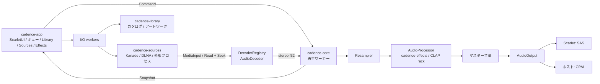

# Cadence の構成

Cadence は Scarlet を主対象にした独立 Rust workspace です。Resonara の
core / platform / app の分割を参考に、再生の状態遷移と音声処理を OS と UI から分離しています。

| crate | 責務 |
| --- | --- |
| `cadence-core` | キュー、再生・一時停止・曲送り・シーク・リピート、ストリーミングデコード、リサンプル、処理チェーン |
| `cadence-platform` | SAS / CPAL の生成、PCM 変換、出力バッファ、デバイスエラー、標準フォルダー選択 |
| `cadence-library` | バージョン付き永続カタログ、ローカル走査、安定したソース ID、メタデータ、画像デコード |
| `cadence-sources` | `SourceRegistry`、Kanade / DLNA、外部プロセスプラグイン、ストリームとセッション管理 |
| `cadence-effects` | Resonara CLAP ホスト、処理チェーン、パラメーター、状態の保存・復元 |
| `cadence` (`crates/cadence-app`) | ScarletUI の画面、ファイル選択、非同期 I/O、設定保存、入力と状態表示 |

## スレッドと音声の流れ

`Player::send` は容量 64 のコマンドチャネルへ非ブロッキングで送信し、満杯ならエラーを返します。
再生ワーカーがファイル、デコーダー、出力デバイスを所有します。UI は `Snapshot` を読み取るだけで、
UI スレッド上ではデコードしません。フォルダー列挙も別ワーカーで行います。

デコーダーはモノラルを左右同一のステレオへ変換し、有限サイズのブロックで PCM を返します。
出力側が受け入れなかった末尾は再生ワーカーが保持します。CPAL のコールバックは
固定容量の SPSC リングを消費し、デコード・ファイル I/O・UI のロック取得を行いません。
SAS は 48 kHz / stereo / S16LE の共有リングへ書き込みます。

一時停止では出力を破棄し、未消費の有限な音声ブロックを保持して再開します。
読み戻しできないストリームも、デコーダーやサーバー接続を開き直さず一時停止できます。
シークでは対応を確認してから出力を破棄し、デコーダーとリサンプラーを再設定します。
次曲のopenと最初のデコードは専用の先読みワーカーで行います。要求チャネルは1件、
ワーカーは1本で、キャンセル後も別ワーカーを増設しません。入力ブロックは出力レートに
合わせて最大2,048入力フレームに制限。自然なEOFでは現在の末尾を送った直後に次曲の
PCMを同じ出力へ続け、CLAPの処理状態も維持します。出力フレーム上の境界を追跡し、
消費が境界へ届いたときだけcurrent／duration／seekableを更新します。境界は最大64件。
表示位置は出力待ちフレームを除いた値で、デバイス内部の遅延は含みません。
一時停止は曲境界を含む未消費PCMを保持し、シーク／キュー編集は無効になった先読みを破棄。
キューは最大16,384曲です。

CPAL は最後のコールバックの予測再生時刻までストリームを保持します。現在の SAS は
ハードウェアの再生完了通知を持たないため、リングが空になってから 240 ms 接続を保持します。
これは固定中の SAS のデバイスバッファ 9,600 フレームと 960 フレーム×2 period、48 kHz に
基づく待機です。このdrainと接続保持はプレイリスト末尾、または次曲が開けない場合の
現在曲の末尾にだけ行います。自然な曲送り／リピートではCPAL streamとSAS接続を維持し、
この待機やSASのdrainフラグを曲間に挟みません。停止・シークは保留中の出力を破棄します。

## 拡張点

- **デコーダー:** `DecoderFactory` と `AudioDecoder` を実装し、
  `DecoderRegistry::register` で登録します。後から登録した factory を優先します。
  ローカル入力は `Path` です。配信サービスは `MediaInput` の再オープン用 closure と
  `MediaSource`（`Read + Seek + Send + Sync`）を渡し、音源ファイルの保存を必要としません。
  入力のキャンセルと世代番号で、古い接続の結果が新しい再生に割り込むのを防ぎます。
- **音声処理:** `AudioProcessor` を実装します。`Player::with_components` は
  `Vec<Box<dyn AudioProcessor + Send>>` を受け取ります。スレッドに所属する CLAP 等には
  `Player::with_processor_factories` を使い、ワーカー内で生成から破棄まで完結させます。
  trait 自体は `Send` を要求しません。`prepare`、`process`、`service` は失敗を返せます。
  出力レートへ変換した後、マスター音量の前に有限ブロックで適用します。
  シーク・曲切り替え等で `reset`、停止中も `service` が呼ばれます。
- **出力:** `OutputFactory` から `AudioOutput` を生成します。`write` は受理したフレーム数を返し、
  容量待ちでブロックしません。`pending_frames`、`check_error`、必要なら `begin_drain` と
  `is_drained` を実装します。リングからの取り出しと実際の再生完了は区別します。
  出力オブジェクトはワーカー内で生成・破棄されるため、デバイスを UI スレッドと共有しません。
- **UI:** `Command` / `Snapshot` の境界を利用して画面を追加できます。
  色は ScarletUI の `ColorPalette`、レイアウトと操作部品は `NavigationView`、`SplitView`、
  `GridView`、`ListView`、`Surface`、`HeaderBar`、`Select`、`Toggle`、`Slider` を使用します。
- **ソース:** `SourcePlugin: Send + Sync` の `browse`、`open_stream`、`materialize`、`fetch_artwork` を実装し、
  `SourceRegistry::register` で登録します。本体を再ビルドしない追加方法として
  [外部プロセスの JSON Lines protocol v1](source-plugin-protocol.md) も利用できます。

## UI の状態と更新範囲

`Cadence` のルート View はウィンドウサイズだけを購読します。`Playback` は再生、キュー、
シークと音量の状態、`BrowserState` はファイルブラウザー、`Workspace` はライブラリーとソース、
`Collections` はアルバム・アーティストと画像、`EffectPane` はエフェクトの状態を所有します。
`presentation.rs` のコンポーネントが必要な状態だけを購読し、再生位置・時刻・音量の変化は
該当する Slider / Text に配送します。型消去用 `AnyView` は子孫の購読をルートへ転送しません。
ページ、再生バー、曲情報には ScarletUI の repaint boundary を置きます。
macOS は System frame / Custom title bar の不透明な内容面を使い、OS が外周を描きます。
透明な外周に起因する、再生位置の変化ごとのウィンドウ全体の再ラスタライズを避けます。

アルバムとアーティストのグループ化はライブラリー変更時だけ行い、音声の更新ごとには行いません。
ローカルアルバムは Kanade と同じく音源の親フォルダーで識別し、フォルダーパス順に並べます。
同じタイトルでも異なるフォルダーは別アルバムで、CD1 / CD2 が別フォルダーなら別々に表示します。
表示アーティストには `album_artist`、なければ `artist` を使い、収録曲は disc → track → title 順です。
アーティスト一覧は `artist` と `album_artist` の集合で、名前の分割やコンピレーションの推測をしません。
リモートアルバムはソース ID とプロバイダーのアルバム ID で識別します。
古いローカルカタログは起動後にI/OワーカーでAlbum Artist / disc / trackを補完します。
完了状態をカタログに保存し、次の起動では繰り返しません。キャンセル・保存失敗の場合は
元のカタログを保持し、オフラインなどで読めなかった音源は次回に再試行します。
詳細の番号欄には保存されたdiscとtrackを表示し、番号が無い曲は「—」とします。
カバーの取得・縮小は独立ワーカーと容量制限付きチャネルで処理し、結果は該当カバーの State だけへ渡します。
最終 BitmapImage への変換もワーカーで行います。BitmapImageは元画像のBufferを共有し、
標準ImageからGPUへ表示サイズ・切り抜き範囲を渡します。スクロール時のCPU拡大縮小と
既存画像の再アップロードは不要です。CPUフォールバックでは画像ごとのrepaint boundaryを使います。
未表示になったカバーの待機要求をキャンセルし、1回のUI処理で公開する画像は最大4枚です。

描画・仮想一覧・ジェスチャーの修正はScarletUI本体へ反映し、
`f0a8b770352bc0b9e57df5c88a7520723a147114`を直接参照しています。UI部品のvendorコピーは不要です。
GPUバックエンドには文字・図形・画像の描画指示を直接渡し、UIをCPUでラスタライズしてから
GPUへアップロードする経路は使いません。CPUバックエンドだけがラスタキャッシュを使用し、
その作業領域も実際の描画範囲に制限します。フォント字形の生成と画像デコードはCPUで行います。
描画はGPUが消去する範囲と一致させ、一覧は内容サイズの変化をScrollViewまで伝えます。
ListView/GridViewは状態変更時にデータを保持し、スクロール中は必要な項目だけ取り出します。
画像用テクスチャは現在フレームで未使用の、必要サイズを収容できる領域を再利用します。
変更範囲と性能検証はScarletUIの`docs/SCROLL_PERFORMANCE.md`に記載しています。
SGFXの同時画像128スロットの制限は維持しています。
アルバム・全曲・ソース内の曲を開くと、`ReplaceTracksAndPlayAt` の単一コマンドで一覧を置き換え、選んだ位置から再生します。
同じ一覧が既にキューにある場合は `Select` で移動します。空・上限超過・不正な位置・送信失敗では元のキューを消去しません。
外部ソースの入力は再生ワーカーで遅延解決し、音声の全体ダウンロードを待ちません。

## ライブラリーと外部ソース

`LibraryTrack` は `source_id + item_id` に基づく安定した ID、メタデータ、音源と画像の参照を持ちます。
ローカルパス、HTTP URL、プロバイダーによる遅延解決を区別します。Kanade と外部プラグインの
期限付き URL は永続化せず、再生時に取得します。`AddTracks` でサービス側の曲情報をキューへ渡すため、
ストリームの内部 ID が曲名になることを防ぎます。

ローカル走査、画像取得・デコード、ネットワーク、カタログ保存は I/O ワーカー上で行います。
世代番号とキャンセルで、曲やソースを切り替えた後の古い結果を表示しないようにします。
JSON は一時ファイルの同期後に置換し、壊れたファイルを読み込んだ場合はそのセッションの保存を止めます。
走査で見つからなかった曲は自動削除しません。カタログは 10 万曲 / 64 MiB、PNG/JPEG は
圧縮データ 8 MiB / 32M pixels に制限し、表示前に最大 512 px へ縮小します。

登録フォルダーを永続化し、再スキャンとソース削除を提供します。
ソース削除は曲もカタログから除去しますが、音声ファイルは変更せず、他の登録フォルダーが共有する曲は残します。
外部ソースはその `source_id` の曲を除去し、カタログ保存に成功してから接続設定を外します。
走査は現在のパスと件数を latest-value として公開し、UI のイベントキューに進捗を蓄積しません。
キャンセルと保存失敗では元のカタログを保持し、保存段階に入るとキャンセル操作を除きます。
走査時のエラー件数は全件数を保持し、詳細は最大 1,024 件です。

Kanade は WebSocket の `get_albums` / `get_album_tracks` / `sign_urls` を使い、再生時に署名します。
再生・一時停止中も独立したワーカーが heartbeat を処理し、ストリームを閉じるまでセッションを保持します。DLNA は device description と ContentDirectory の SOAP Browse を使い、
ページを辿って DIDL-Lite の音声・アルバム画像を読みます。DLNA の仕様は
[ContentDirectory v1](https://upnp.org/specs/av/UPnP-av-ContentDirectory-v1-Service.pdf) と
[Device Architecture 1.1](https://upnp.org/specs/arch/UPnP-arch-DeviceArchitecture-v1.1.pdf) を参照しています。
DLNA の新規カタログは object ID を保存し、再生時の BrowseMetadata で音源 URL を解決します。
ストリームは 256 KiB の Range 単位、1 回の read は最大 64 KiB で処理します。
HTTP 206 の範囲・全長・Content-Length・ETag 等を検査し、途中切断や別の表現の連結をエラーにします。
Range を無視する HTTP 200 は forward-only として再生し、シークできるとは表示しません。
明示的な `materialize` は従来の上限（512 MiB / キャッシュ 2 GiB）で残しています。

## CLAP の境界

`EffectRack` は UI 向け `EffectController` とワーカー向け `ProcessorFactory` を返します。
インスタンス生成、パラメーター処理、音声処理、状態保存、破棄は再生ワーカーに集約します。
標準ディレクトリの走査とdescriptor-onlyの探索は独立ワーカーで行い、再生を止めません。
Resonaraのライブラリーleaseにより、使用中のDSOを探索してもentryのinit/deinitを重複させません。
CLAPインスタンスを `unsafe Send` で移動しません。
保存済みチェーンの復元は、ScarletUIがメインスレッドで最初のOSイベントを処理した後に開始します。
読み込み失敗で元の保存済みチェーンを空に置き換えません。
UI へは通常の Rust データのスナップショットだけを渡します。

チェーンは最大 32 エフェクトです。並べ替えでインスタンスを維持し、パラメーター変更では対象のみ
deactivate / flush / reactivate します。このため、そのエフェクトの内部履歴がリセットされる場合があります。
状態は 1 エフェクト 1 MiB、合計 8 MiB まで。JSON 化した設定には別途 40 MiB の上限があります。
現在のホストは stereo / f32 / zero-latency effects が対象で、専用 GUI、MIDI、楽器、レイテンシー補償、
EOF 後の tail 延長はありません。プラグインはアプリと同じプロセスで動作します。

## プラットフォーム境界

Scarlet では ScarletUI `platform-sws` と SAS、ホストでは `platform-winit` と CPAL を選びます。
画面と再生ロジックは共通で、`target_os = "scarlet"` の音声出力差分は `cadence-platform` に集約しています。
ファイル選択は ScarletUI 共通 API を利用します。macOS のフォルダー選択は
`cadence-platform` の非同期 NSOpenPanel sheet を使います。標準フォルダー選択が未対応の環境では
アプリ内ブラウザーへ移ります。SWS のファイル選択は現在単一ファイルです。

依存は Cargo manifest の Git revision と `Cargo.lock`、開発環境は `flake.lock` に固定しています。
通常ビルドには隣接する Scarlet / ScarletUI / SGFX checkout は不要です。
`vendor/sws-protocol` の wire protocol 更新だけを workspace の portable patch として保持しています。
Scarlet の実行には対応する SWS、SAS、動的 SGFX ドライバー、`scarlet-ld` を含む OS イメージが必要です。
CLAP は OS / CPU に合うバイナリーが必要です。ソース層のホスト通信は TLS に対応しますが、
Scarlet は現在 HTTP / WS のみです。WebSocket 用乱数は Scarlet の entropy-required syscall を使用します。
外部プロセス型ソースは、現在の Scarlet 標準ライブラリーで `Child::kill` が未対応のため無効です。
タイムアウト後も終了できない子プロセスを残さないための制約で、組み込みソースには影響しません。

## 初期実装の範囲

プレイリスト保存、シャッフル、ギャップレス、DLNA 自動検出は未実装です。
入力はモノラル / ステレオに限定します。
現在の線形補間リサンプラーはダウンサンプリング用ローパスフィルターを持たず、
折り返し雑音を抑制できません。高音質変換を追加する場合はこの段階を交換します。

ビルド・単体テストと、GUI / SWS / SAS / 実際の出音の確認は別の検証です。
クロスビルドの成功だけで Scarlet 実行確認済みとは扱いません。

## ウィンドウとコンテンツの寸法

装飾はバックエンドのデフォルトを使い、winitではシステム、Scarlet/SWSではScarletUIに任せます。
コンテンツを親の領域へ広げ、既存の `on_geometry_change` で実際のサイズを受け取ります。
アプリ側でタイトルバーの高さを差し引かず、プラットフォームのsurfaceサイズをコンテンツサイズとして扱いません。
最小サイズは `Window::min_size` からwinitへ渡され、アプリ独自のAppKit補正はありません。

OSからのリサイズ通知はScarletUIの `apply_resize` で反映し、明示的な
ウィンドウサイズ要求と分離しています。runnerは描画済みサイズと実ウィンドウサイズを
毎tick比較するため、復元やネイティブリサイズの通知が欠けても描画先を更新します。
Macではwinitのネイティブイベントループ内でtickを実行し、リサイズ・再描画の
コールバックが戻る前にレイアウトと描画を完了します。AppKitのtracking中に
イベントループを停止しないため、リサイズ終了後に引き伸ばし状態が残りません。
通常クリックを壊したpump後のボタン状態pollingは撤去し、focus喪失時だけcaptureを
キャンセルします。

リスト内の複数行テキストは自然な高さのVStackにまとめ、HStackの中央へ配置します。
各テキストやVStackに固定高さを与えて上下の間隔を広げません。番号・再生中アイコン・時刻も同じ行の中央に揃えます。
キューの再生中マークはScarletUIの `Icon::PlayerPlay` を使用します。

Now Playingは通常表示・コンパクト表示とも左右の列を同じ幅に取り、再生ボタンを
バー全体の中央に置きます。狭い表示では音量スライダーの幅を縮め、450px未満では
音量とリピートを省略します。ScarletUIのSliderは有限の幅制約を尊重し、
100px未満の領域を割り当てられてもセル外へ張り出しません。
